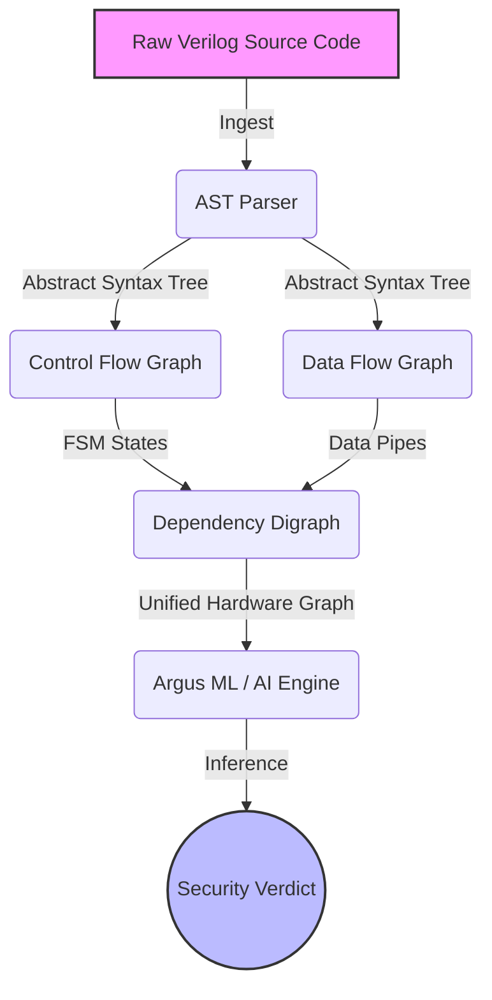

# Project Argus

**Project Argus** is a state-of-the-art cybersecurity framework designed to analyze hardware designs (like computer chips and processors) to detect malicious tampering (Hardware Trojans) and intellectual property theft (IP Piracy). 

By reading the blueprints of a hardware chip (written in Verilog), Argus translates the code into a mathematical graph. It maps out how data moves around the chip and how decisions are made, and then feeds this vast web of connections into a Graph Neural Network (AI) to spot hidden vulnerabilities.

---

## How It Works (The Big Picture)

Imagine you have a complex blueprint for a factory. It's incredibly hard to spot a hidden, malicious conveyor belt just by reading thousands of pages of text. 

Project Argus solves this by automatically drawing out a map of the factory:
1. **Reading the Blueprint:** It reads the raw code of the chip.
2. **Finding the Control Rooms:** It maps out the "state machines"—the brains that decide what the chip does at any given moment.
3. **Tracing the Pipes:** It traces exactly how data flows from one component to another.
4. **Building the Map:** It merges the control rooms and the data pipes into one massive, unified map.
5. **AI Inspection:** It hands this map to an AI trained to recognize the subtle, hidden patterns of sabotage or stolen designs.



---

## Technical Architecture

Project Argus has been strictly decoupled into independent, isolated micro-modules. This "Zero Cross-Dependency" architecture allows researchers to work on, test, and upgrade individual components without breaking the rest of the pipeline.

### 1. `argus_ast` (Verilog AST Parser)
**Branch:** `feature/verilog-ast-parser`
* **Purpose:** The ingestion layer. Parses IEEE 1364-2001 Verilog RTL into an Abstract Syntax Tree (AST).
* **Tech Detail:** Leverages `pyverilog` under the hood. Strips comments, identifies the top-level module dynamically, and serializes the raw PyVerilog `Source` node into an `ast.pkl` artifact. This creates a lossless contract for downstream consumers.

### 2. `argus_cfg` (Control Flow Extractor)
**Branch:** `feature/ast-to-cfg`
* **Purpose:** Identifies Finite State Machines (FSMs) and control logic.
* **Tech Detail:** Analyzes the AST for state registers and state transitions. Bypasses legacy graphical dependencies (like PyGraphviz) in favor of emitting a strict, lightweight `cfg.json` schema containing FSM states, guards, and transition conditions.

### 3. `argus_dfg` (Data Flow Extractor)
**Branch:** `feature/ast-to-dfg`
* **Purpose:** Traces data movement and logical operations.
* **Tech Detail:** Walks the PyVerilog dataflow tree for every assigned net/register. Generates a directed multi-graph tracking operand-to-operator dataflow. Emits a strict `dfg.json` schema.

### 4. `argus_digraph` (Unified Dependency Graph)
**Branch:** `feature/dependency-digraph`
* **Purpose:** Merges Data and Control flows to reveal deep dependencies.
* **Tech Detail:** Ingests `cfg.json` and `dfg.json`. Discovers logical intersections—for example, if a DFG branch condition is governed by an FSM register from the CFG, it injects a `control_dep` (control dependency) edge. Outputs a unified `digraph.json` compatible with `networkx`.

### 5. `argus_ml` (Machine Learning Engine)
**Branch:** `feature/argus-ml`
* **Purpose:** The AI brain. Detects Trojans and IP theft.
* **Tech Detail:** A custom Graph Neural Network (GNN) engine built in `PyTorch` and `PyTorch Geometric`. Replaces legacy libraries with a highly optimized `GraphEncoder` backbone. Supports both GIN/GCN convolutions and TopK/SAG pooling. Wraps the input `digraph.json` into PyTorch `Data` objects for training/inference.

### 6. `argus_controller` (Master Orchestrator)
**Branch:** `core/argus-controller`
* **Purpose:** Pipes everything together.
* **Tech Detail:** Invokes the pipeline end-to-end. Instead of writing JSONs to disk between steps, the controller passes Python dictionaries directly between modules in memory for maximum I/O performance.

---

## Quickstart & Usage

### Running the Full Pipeline
To run the pipeline from end-to-end, checkout the `core/argus-controller` branch and run the master orchestrator:

```bash
# Activate the Python environment
.\.venv\Scripts\activate

# Run the controller on a Verilog design
python modules/argus_controller/src/argus_controller/pipeline.py path/to/design.v --top my_top_module --out ./final_out/
```
*This will output the final merged dependency graph ready for the ML engine.*

### Running Modules Independently
Because of the decoupled architecture, you can run any module individually if you have the required input file:

```bash
# Generate the AST only
python -m argus_ast path/to/design.v --top my_top_module --out ./out/

# Generate the DFG from an existing AST
python -m argus_dfg ./out/ast.pkl --out ./out/

# Train the ML model on generated graphs
python -m argus_ml train --config config.yaml
```

## Contributing
Each feature module resides on its own `feature/*` branch and contains a `CONTRACT.md` defining its strict I/O boundaries. When making changes, ensure your module passes its independent `pytest` suite before requesting a merge into the `core/argus-controller` integration branch.
